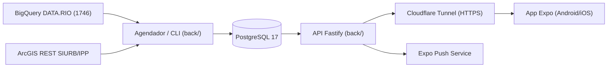

# Arquitetura Técnica — Fiscaliza aí

Visão consolidada da arquitetura atual do sistema. Para escopo de produto e limites de interpretação, consulte [PRODUCT.md](../PRODUCT.md); para escolhas tecnológicas e trade-offs detalhados, consulte [decisoes.md](decisoes.md).

## 1. Visão Geral dos Componentes

- **`front/` (Aplicativo Móvel):** Expo SDK 58 (React Native 0.88, React 19.3, Nova Arquitetura) com Expo Router. Mapa nativo em Mapbox (`@rnmapbox/maps`, fallback para lista no Expo Go), estado remoto via TanStack Query (com cache persistido) e estado local/preferências via Zustand com isolamento por conta e município.
- **`back/` (API e Agendador):** Fastify 5 (TypeScript estrito), Drizzle ORM sobre PostgreSQL 17, validação de entrada por JSON Schema, logs estruturados (`pino`), integração com Sentry e agendador em Node (`scheduler-cli`) para sincronização periódica e limpeza de anexos.
- **`shared/` (Contratos Públicos):** tipos e helpers compartilhados entre app e API (`contracts.ts`, `public-data.ts`, `official-map.ts`, `registration.ts`).
- **`deploy/` (Operação):** Docker Compose (API, agendador, PostgreSQL 17, backup diário e túnel `cloudflared`), scripts de deploy, backup (`pg_dump -Fc` + uploads) e restauração.

## 2. Fluxo de Dados

O aplicativo móvel nunca consulta BigQuery ou ArcGIS diretamente. Toda leitura passa pelo PostgreSQL sincronizado no servidor.

## 3. Grupos de Endpoints HTTP

- **Saúde e monitoramento:** `GET /health`, `GET /api/health`, `GET /api/health/deep` (público, sem cache; informa `lastSuccessAt` e `ageSeconds` por fonte de sincronização).
- **Autenticação e conta cidadã (LGPD):** `POST /api/auth/register`, `POST /api/auth/login`, `GET /api/auth/me`, `PUT /api/auth/avatar`, `DELETE /api/auth/profile` (exige senha no corpo; remove conta, sessões em cascata e arquivos de avatar), `POST /api/auth/logout`, `POST /api/auth/logout-all`, `GET /api/auth/cep/:cep` e `PUT /api/auth/municipality`.
- **Chamados oficiais (1746):** `GET /api/rio1746/calls` (paginação por cursor ou página e filtros unificados), `GET /api/rio1746/map` (agregação espacial em grade por viewport, sem paginação), `GET /api/rio1746/calls/:id`, `GET /api/rio1746/filters`, `GET /api/rio1746/neighborhoods`, `GET /api/rio1746/sync-status`.
- **Cadastros territoriais (SIURB/IPP):** `GET /api/data-sources`, `GET /api/public-facilities` (paginado), `GET /api/public-facilities/:id`, `GET /api/territorial-boundaries`, `GET /api/territorial-boundaries/:id`, `GET /api/neighborhoods/:id/overview`.
- **Chamados salvos sincronizados:** `GET /api/v1/saved-calls`, `PUT /api/v1/saved-calls/:callId`, `POST /api/v1/saved-calls/merge` (adoção em lote de até 200 itens), `DELETE /api/v1/saved-calls/:callId`, `DELETE /api/v1/saved-calls` (limite de 500 por conta; sem conta, salvos ficam apenas no aparelho).
- **Avisos push:** `POST /api/v1/notifications/push-token`, `DELETE /api/v1/notifications/push-token`, `POST /api/v1/notifications/follow`, `DELETE /api/v1/notifications/follow`.
- **Anexos (avatares):** `POST /api/attachments` e `GET /api/attachments/:id` (validam assinatura, MIME e tamanho; servidos com `Cache-Control: private, no-store`).

## 4. Garantias de Segurança, Privacidade e Resiliência

- **Contas exclusivamente cidadãs:** não existem papéis administrativos na API; importações ocorrem apenas por CLI/agendador no servidor.
- **Validação territorial no servidor:** pontos e alterações de município são validados contra o polígono oficial (IBGE `3304557`) e CEP no backend.
- **Privacidade:** `numero_logradouro` dos chamados do 1746 é omitido na API pública; sessões opacas são armazenadas por hash; bloqueio de login por IP e por conta.
- **Controle de execução:** sincronizações possuem trava por fonte no PostgreSQL, orçamento de bytes no BigQuery (`500 MB` padrão) e publicação cadastral atômica.
