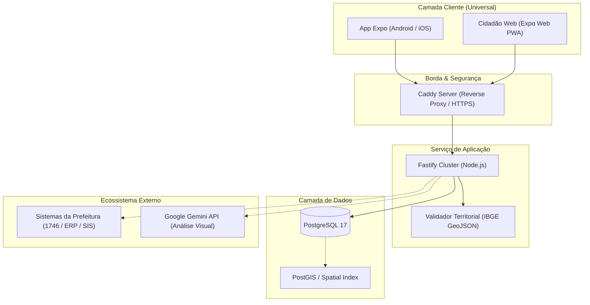

# Decisões de Arquitetura e Engenharia — Fiscaliza aí

Este documento sintetiza a visão técnica, os critérios de escolha, os tradeoffs deliberados e as diretrizes de escalabilidade do **Fiscaliza aí**, servindo como guia de alinhamento para engenheiros e lideranças técnicas.

---

## 1. Escolhas Tecnológicas

| Camada | Tecnologia Adotada | Alternativas Consideradas | Racional da Decisão |
|---|---|---|---|
| **Mobile / Frontend** | **Expo SDK 57 (React Native 0.86)** com **Expo Router** | Flutter, React Native bare, PWA pura | • **Universalidade com base única**: compila para Android, iOS e Web a partir da mesma árvore de código.<br>• **Expo Router (File-based routing)**: rotas fortemente tipadas (`/app/(tabs)`), deep linking nativo, layouts aninhados e navegação declarativa sem boilerplate de boilerplate navigation.<br>• **Velocidade de iteração**: Expo Go e Prebuild eliminam dependências de compilação C++/Gradle pesadas em etapas iniciais. |
| **Motor de Mapas** | **WebView + Leaflet + OpenStreetMap + Leaflet.markercluster** | `react-native-maps` (Google/Apple Maps nativo), `expo-maps` (v1/alpha) | • **Acessibilidade e custo zero**: sem obrigatoriedade de faturamento do Google Cloud / API Keys no cliente.<br>• **Compatibilidade total**: funciona de forma idêntica em iOS, Android (inclusive Expo Go) e Web.<br>• **Controle vetorial total**: marcadores em SVG com alinhamento milimétrico, clustering dinâmico com comportamento customizado (zoom progressivo para >10 itens e carrossel para ≤10) sem limitações de bridges nativas proprietárias. |
| **Backend & API** | **Fastify (TypeScript)** | Express, NestJS, Go (Gin/Fiber) | • **Performance e baixo consumo**: arquitetura assíncrona leve com menor overhead de I/O que o Express.<br>• **Validação nativa de schema (Ajv / JSON Schema)**: validação estrita de payload antes de tocar a lógica de negócio, garantindo tipos em tempo de execução.<br>• **Modularidade sem complexidade acidental**: plugins isolados sem o peso de decorators e injeção de dependência intrusiva do NestJS. |
| **Banco de Dados & ORM** | **PostgreSQL 17 + Drizzle ORM** | Prisma, TypeORM, MongoDB | • **Consistência relacional estrita**: relações cívicas, auditoria de mudanças de status, votos únicos e restrições de chave estrangeira exigem ACID estrito.<br>• **Drizzle ORM**: consultas SQL-like de altíssimo desempenho, migrações determinísticas em TypeScript, zero overhead de runtime engine (ao contrário do binário em Rust do Prisma) e tipagem segura ponta a ponta compartilhada com o frontend (`shared/contracts.ts`). |
| **Inteligência Artificial** | **Google Gemini (Server-side)** | Modelos locais (ONNX), OpenAI GPT-4 Vision | • **Segurança arquitetural**: chaves de API e prompts permanecem restritos ao servidor Fastify; o cliente nunca expõe credenciais de IA.<br>• **Fallback gracioso**: caso o serviço de IA esteja indisponível ou sem chave configurada, o sistema ativa imediatamente heurísticas locais determinísticas sem interromper a jornada do cidadão. |
| **Gerenciamento de Estado** | **Zustand + TanStack Query (React Query)** | Redux Toolkit, Context API puro | • **Zustand**: stores globais ultra-leves para sessão (`authStore`), preferências territoriais (`territoryStore`) e tema (`themeStore`), sem reducers verbosos.<br>• **TanStack Query**: separação clara entre estado da interface (local) e cache assíncrono do servidor (invalidação, refetch em foco, retentativas e estados de carregamento/erro). |

---

## 2. Tradeoffs e Dívida Técnica

Toda decisão de engenharia em estágio inicial busca equilibrar velocidade de entrega com sustentabilidade arquitetural. Abaixo estão os tradeoffs assumidos e seus planos de mitigação:

### 2.1. Mapa em WebView vs. Mapa Nativo (MapLibre / Native SDK)
* **O que foi feito**: Uma camada Leaflet/OSM envelopada em WebView com ponte de comunicação via `postMessage`.
* **Tradeoff**: Ganhamos compatibilidade universal imediata (Expo Go, Web, Android e iOS sem chaves de API pagas), mas há um custo marginal de performance em dispositivos de entrada sob milhares de marcadores simultâneos.
* **Resolução Prioritária**: A introdução de clustering no Leaflet mitigou 90% do gargalo de renderização. A longo prazo, quando houver demanda de offline mapping em nível de malha vetorial completa, a migração para `MapLibre React Native` será realizada atrás da interface `OsmMapViewProps`, isolando os componentes de negócio dessa mudança.

### 2.2. Remoção do Painel Web Municipal Dedicado
* **O que foi feito**: O diretório `municipal/` foi completamente removido do repositório.
* **Tradeoff**: Não manteremos uma interface web própria para servidores públicos dentro deste monorepo.
* **Racional Estratégico**: Prefeituras e órgãos públicos já operam canais consolidados de atendimento (e.g., sistemas 156/1746, ERPs públicos ou CRMs de zeladoria). Criar um painel concorrente geraria fricção de adoção e duplicidade operacional.
* **Resolução Prioritária**: O backend do Fiscaliza aí foi mantido como autoridade canônica. A evolução focará na disponibilização de **Webhooks e APIs de Integração bidirecional** (OpenAPI padronizado), permitindo que ocorrências registradas pelo cidadão sejam despachadas diretamente para os sistemas oficiais de gestão da cidade.

### 2.3. Armazenamento de Fotos Local vs. Object Storage (S3 / R2 / GCS)
* **O que foi feito**: Uploads salvos em volume de disco montado (`/app/uploads`), servidos via Fastify com validação de assinatura de arquivo.
* **Tradeoff**: Simplicidade operacional máxima para desenvolvimento e deploy em VPS única, mas cria dependência de disco persistente não distribuído.
* **Priorização**: Para escala de produção multi-região, abstrair o serviço de upload para um adapter compatível com S3 (AWS S3 ou Cloudflare R2 com CDN), gerando presigned URLs para upload direto do cliente e preservando a integridade do backend.

### 2.4. Atualização de Dados: Polling & Refetch vs. WebSockets / SSE
* **O que foi feito**: Atualizações de ocorrências e iniciativas são sincronizadas por gatilhos de foco e navegação via React Query.
* **Tradeoff**: Economia de bateria no dispositivo móvel e eliminação de conexões persistentes ociosas no servidor, com latência de poucos segundos na visualização de mudanças de status.
* **Priorização**: Manter polling na maioria das telas e introduzir Server-Sent Events (SSE) exclusivamente na tela de acompanhamento detalhado (`ProblemDetailsScreen`) quando houver intervenção ativa em andamento.

---

## 3. Padrões e Boas Práticas

Para manter a consistência entre múltiplos desenvolvedores, o projeto segue diretrizes rigorosas de engenharia:

### 3.1. Arquitetura de Pastas e Responsabilidades
```
fiscaliza-ai/
├── app/               # Rotas exclusivas do Expo Router (sem regras de negócio pesadas)
├── features/          # Módulos verticais de domínio (city, reports, onboarding)
├── components/        # Componentes visuais desacoplados e reutilizáveis (ui, territory)
├── theme/             # Tokens do Design System (colors, spacing, layout, useTheme)
├── stores/            # Estados locais da aplicação (Zustand)
├── services/          # Clientes HTTP, adaptadores de transporte e APIs externas
├── shared/            # Contratos de tipos TypeScript compartilhados entre App e API
└── backend/           # API Fastify, schemas Drizzle, migrações e testes de integração
```

### 3.2. Contratos Compartilhados (`Single Source of Truth`)
* Qualquer contrato de dados (interfaces de `Occurrence`, `CivicItem`, `SessionUser`, payloads de mutação) reside em `shared/contracts.ts`.
* O frontend e o backend consomem as mesmas definições de tipos, eliminando divergências de serialização e desserialização.

### 3.3. Convenções de Código e Linting
* **TypeScript Estrito**: `strict: true`, sem uso de `any` implícito. Casts de tipo arbitrários (`as unknown as X`) são rejeitados.
* **Linter Automatizado**: `expo lint` (baseado nas regras recomendadas da comunidade React Native/Expo) integrado aos workflows do GitHub Actions.
* **Princípio RITO**: Razão, Informação, Tarefa e Originalidade. Interfaces limpas, tipografia legível (`Instrument Sans`), sem slogans genéricos, sem cards aninhados desnecessários e com estados de erro/carregamento declarativos.

### 3.4. Estrutura de Commits
Adotamos o padrão **Conventional Commits**:
* `feat(territory): add marker clustering and horizontal card carousel`
* `fix(backend): correct IBGE polygon raycasting on boundary points`
* `refactor: clean up municipal dashboard dependencies from CI`
* `test(reports): add unit test for location coordinate validation`

Commits devem ser atômicos e autoexplicativos, viabilizando geração de changelogs e rastreabilidade de regressões.

### 3.5. Estratégia de Testes
A pirâmide de testes prioriza velocidade e proteção contra quebras de regras cívicas:
1. **Testes Unitários Puros (`demo/*.test.ts`, `scripts/*.test.cjs`)**:
   - Execução ultrarrápida via runner nativo do Node.js (`node --test`).
   - Validam lógica de negócios isolada: normalização de bairros, ordenação territorial, precedência de perfis, heurísticas de classificação de imagem e regras de expiração de consultas.
2. **Testes de Integração de API (`backend/test/*.test.js`)**:
   - Testam endpoints reais Fastify e consultas SQL.
   - Cobrem autenticação, cookies de sessão, CSRF, limites de taxa, validação de polígonos territoriais e unicidade de apoios comunitários.
3. **Smoke Tests e Pré-deploy (`.github/workflows/validate.yml`)**:
   - Verificação estática (`npx tsc --noEmit`), lint (`npm run lint`), compilação de contrato OpenAPI e teste de export web antes de qualquer release.

---

## 4. Escalabilidade e Manutenção

O desenho arquitetural do Fiscaliza aí prevê o crescimento sustentável ao longo de quatro dimensões críticas:



### 4.1. Escala Territorial e Volume de Dados
* **Particionamento por Município**: Todas as tabelas críticas (`records`, `attachments`, `comments`, `supports`) são particionadas logicamente pela coluna `municipality_id` (código IBGE de 7 dígitos). À medida que novas cidades entram na base, o banco pode particionar fisicamente as tabelas por range/list de IBGE.
* **Evolução Espacial com PostGIS**: O validador atual em memória (Raycasting em GeoJSON oficial do IBGE) atende com precisão até dezenas de milhares de requisições. Para escala de milhões de pontos, ativaremos a extensão **PostGIS** com índices espaciais `GIST` (`ST_Contains(geom, ST_SetSRID(ST_Point(lng, lat), 4326))`), transferindo a checagem poligonal para o motor indexado do banco.

### 4.2. Escala de Tráfego e Concorrência
* **Statelessness da API**: A instância Fastify é 100% stateless. A sessão do usuário é verificada via tokens criptografados/cookies assinados. Múltiplos containers da API podem rodar em paralelo atrás de um balanceador (Caddy / Nginx / AWS ALB) sem necessidade de afinidade de sessão.
* **Cache em Camadas**:
  - Dados estáticos do município (malha de bairros e polígono IBGE): armazenados em memória no processo ou Redis com TTL longo.
  - Consultas e Ações públicas: invalidação baseada em eventos (cache-aside via Redis).

### 4.3. Multi-secretarias e Roteamento Setorial
* Em um cenário de prefeitura de grande porte, as ocorrências não pertencem a uma entidade monolítica, mas a secretarias distintas (Conservação, Iluminação Pública, Meio Ambiente, Transporte).
* **Roteamento Inteligente**: A classificação assistida por IA e as categorias pré-definidas associam cada ocorrência a uma tag de competência (`service_unit`).
* **Webhooks por Unidade**: A API disparará eventos específicos (`occurrence.created`, `occurrence.updated`) para endpoints registrados de cada secretaria responsável, permitindo que cada órgão acompanhe e responda no seu próprio ritmo sem travar a base central.

### 4.4. Manutenibilidade e Ciclo de Vida
* **Isolamento de Mudanças**: O desacoplamento rígido entre `app/` (rotas), `features/` (regras e fluxos) e `components/` (UI pura) garante que refatorações visuais ou atualizações de dependências (e.g. novas versões do Expo SDK) não quebrem regras de negócio nem exijam reescrita de testes de integração.
* **Observabilidade**: Fastify integrado com Pino Logger estruturado em JSON, pronto para ingestão por ferramentas de monitoramento (Prometheus, Grafana, Datadog ou OpenTelemetry).
