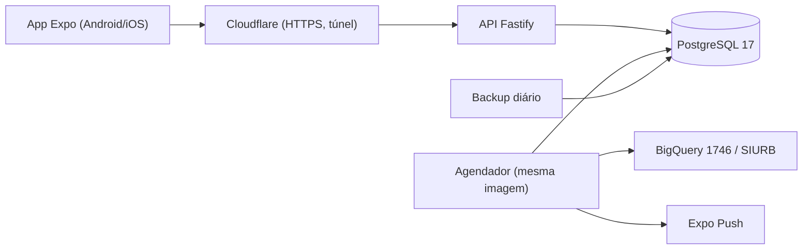

# Decisões de arquitetura e engenharia — Fiscaliza aí

Síntese das escolhas técnicas, dos limites assumidos e de como o sistema cresce. O produto está descrito em [`PRODUCT.md`](../PRODUCT.md); as regras de trabalho, em [`AGENTS.md`](../AGENTS.md). Atualizado em 13/11/2026, depois da revisão geral (`plan/evidence/2026-11-13-*`).

## 1. Escolhas tecnológicas

| Camada | Tecnologia | Por quê |
| --- | --- | --- |
| App | **Expo SDK 58** (React Native 0.88, React 19.3, Nova Arquitetura) com **Expo Router** | Uma base para Android e iOS, rotas por arquivo, builds pelo EAS. Não há versão web publicada. |
| Mapa | **Mapbox** (`@rnmapbox/maps`) | Pontos e grupos desenhados pela GPU a partir de um único GeoJSON (`ShapeSource` com `cluster`), estilos `streets-v12` e `dark-v11`. Sem o módulo nativo (Expo Go), a lista é a visão principal. |
| API | **Fastify 5** (TypeScript, compilado com `tsc`) | Validação por JSON Schema antes do código da rota, baixo custo por requisição, plugins sem injeção de dependência. |
| Dados | **PostgreSQL 17 + Drizzle ORM** | Integridade relacional (chaves estrangeiras com `ON DELETE CASCADE`, unicidade de salvos e seguidores). O Drizzle é o construtor de consultas; as migrações são SQL versionado com checksum (`back/migrations`). |
| Estado no app | **TanStack Query + zustand** | Query para dados do servidor (cache, cancelamento, foco e rede via `focusManager`/`onlineManager`, cache persistido para abrir sem internet); zustand para sessão, preferências e lugares, com persistência separada por conta e município. |
| Importação | **BigQuery** (1746, Data.Rio) e **SIURB/IPP** | Só o servidor consulta as fontes; o app lê a API. Cada execução tem orçamento de bytes e trava por fonte. |
| Avisos | **Expo Push** | O servidor avisa quem segue um chamado quando a situação publicada muda, com caixa de saída para reenviar o que falhou. |
| Erros | **Sentry** | App, API e agendador, sem dados pessoais (só o id da conta). Sem DSN, nada é enviado. |

## 2. Limites assumidos

- **Sem participação nem escrita pública.** O app não registra ocorrências, propostas, consultas ou ações. As tabelas desse período foram removidas (migração `0019`) depois de guardado o dump. O caminho para pedir um serviço é o canal oficial (1746).
- **Sem painel municipal e sem papéis de gestão.** Contas são só de cidadãos; importações são comandos do servidor.
- **Fotos em disco.** Hoje só existe a foto de perfil, em volume do container, servida com `Cache-Control: private, no-store`. Object storage só faria sentido com mais de uma instância da API.
- **Uma instância da API.** A fila de escritas por usuário e o cache de respostas ficam na memória. Com mais de uma instância, a serialização volta para o banco (`pg_advisory_xact_lock` em transação curta) e o cache para fora do processo.
- **Base do 1746 parcial.** A sincronização diária relê os dias recentes e os chamados abertos que alguém salvou ou acompanha. A ausência de um chamado na base não prova que ele não exista no 1746.
- **Atualização por consulta, não em tempo real.** O app renova dados no foco da tela, ao voltar para o app e ao reconectar. Não há WebSocket nem SSE.

## 3. Padrões

### Organização
```
fiscaliza-ai/
├── front/      # App Expo (app/ rotas, features/, components/, theme/, stores/, services/, tests/)
├── back/       # API Fastify, migrações, integrações, agendador e testes
├── shared/     # Contratos usados pelo app e pela API
├── deploy/     # Scripts de deploy, backup e restauração
└── plan/       # Decisões, planos e evidências
```
Instalações npm independentes em `front/` e `back/`, sem workspaces.

### Contratos
Tipos de resposta e de payload ficam em `shared/` (`contracts.ts`, `public-data.ts`, `registration.ts`) e são importados pelos dois lados. O servidor valida toda entrada com JSON Schema; o tipo compartilhado não substitui a validação.

### Código
TypeScript estrito nos dois projetos; `expo lint` no app. Commits em Conventional Commits (`feat`, `fix`, `refactor`, `docs`), em português.

### Testes
- **App:** `node --test` para regras puras e stores; Jest com React Native Testing Library para componentes.
- **API:** `node --test` contra Fastify real e PostgreSQL de teste (banco terminado em `_test`); no CI, sem banco a suíte falha em vez de pular.
- **CI** (`.github/workflows/validate.yml`): tipos, lint, testes, auditoria de dependências, export Android, build da imagem Docker e validação do pacote de deploy.

## 4. Infraestrutura e crescimento



- **Hoje:** API, agendador, Postgres, backup e `cloudflared` em Docker Compose no PC (`compose.yaml` + `compose.public.yaml`), API em `127.0.0.1:43001`. O `compose.production.yaml` e o `release.yml` preparam a VPS.
- **Território:** a checagem de ponto dentro do município e do bairro é feita em memória sobre o GeoJSON oficial. Com muito mais volume, a troca natural é o PostGIS com índice GIST.
- **Outros municípios:** o município vem da sessão (código IBGE) e as chaves locais do app levam conta e município; a importação do 1746 é específica do Rio.
- **Observabilidade:** logs JSON (pino) com id de requisição vindo do `cf-ray`, Sentry para erros e pings de monitor no agendador e no backup (Healthchecks.io, quando configurado).
